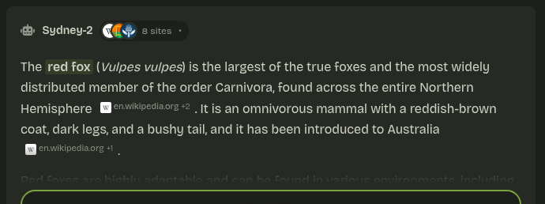
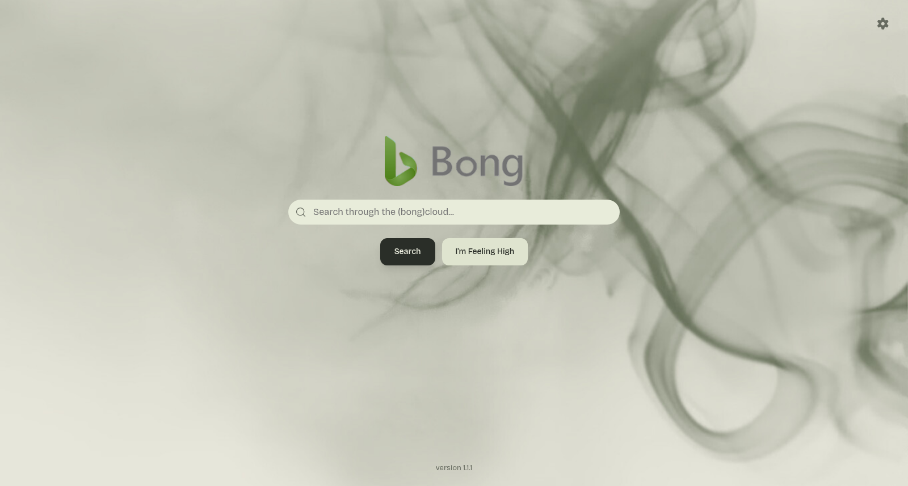
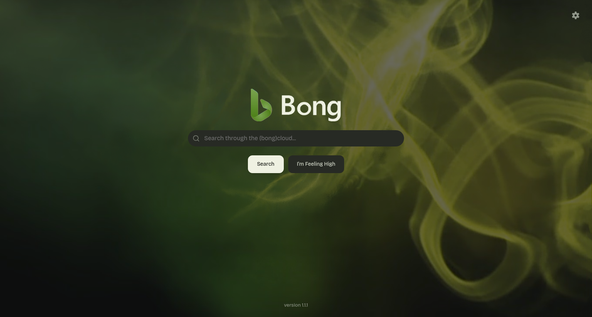
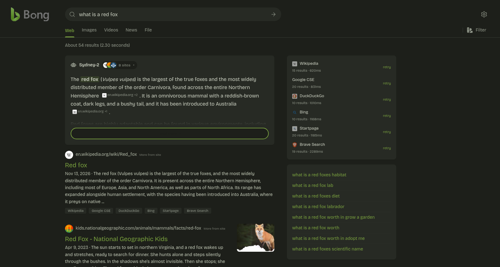

# macrogem-web-suite

Microsoft Parody plugins I made for fun and personal use.

Community plugins and themes for [degoog](https://github.com/degoog-org/degoog) 

## Deep AI Summary — `plugins/deep-ai-summary`

AI summary panel, forked from the official [AI Summary](https://github.com/degoog-org/official-extensions) plugin (same slot, same providers, same look), plus:

    

1. **Full-page context:** instead of summarizing only the search snippets, the top result pages are fetched server side and their main text is given to the model as primary evidence (`--- Source [N] full text ---` blocks). Per-page char caps and timeout, and failures fall back to the snippet, so a broken page never breaks the summary. Extraction is built in.
2. **Custom panel title:** the panel badge text is a setting.
3. **Max sources:** how many results the summary cites at all.

## Bong — `themes/bong`

- Bong theme.

    

    

    

