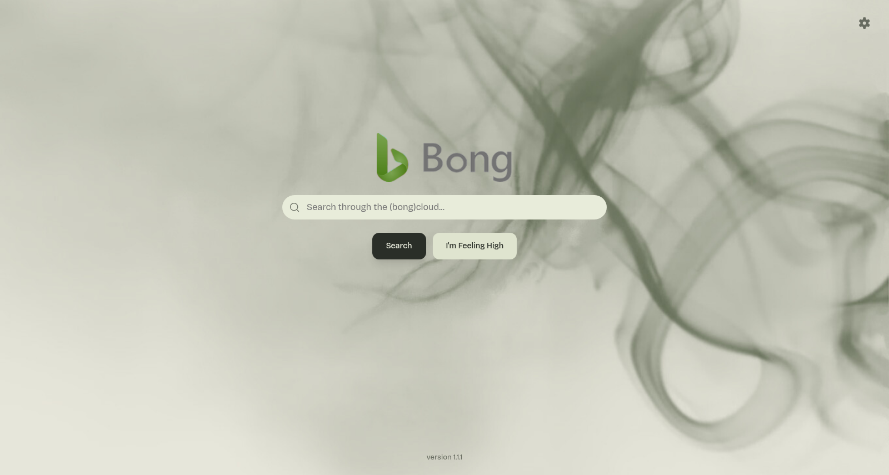
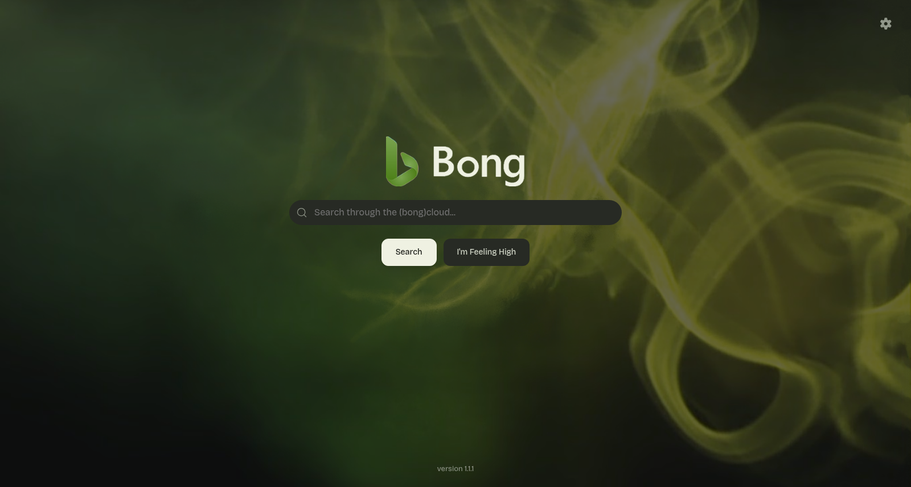
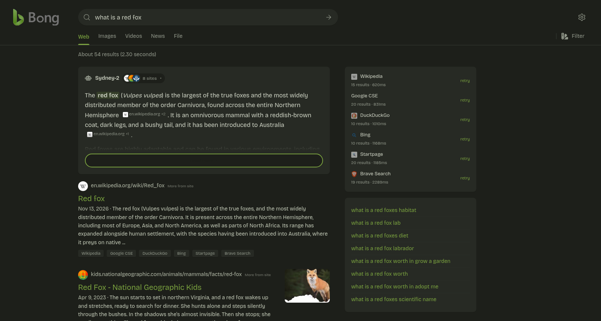

# Bong Theme

    
    
    

- Bong banner as the homepage and results logo: `Bong3.png` everywhere; the homepage swaps to `Bong3-dark.png` (white text) in dark mode
- Breaking Bad intro green smoke as the home-page background: `smoke-light.jpg` (inverted: olive wisps on cream, light mode), `smoke2.jpg` (pre-dimmed, dark mode); `smoke.jpg` is the untouched original
- Homepage logo 260px, results header logo 128px
- Results tabs, meta line, result column and filter fields aligned to the search bar
- AI summary panel title restyled via CSS

Everything lives in `style.css`. `layout.html` keeps `__CUSTOM_CSS__`, so the
Custom CSS field still works as an override layer on top.

Editing `style.css` requires a server restart (theme CSS is compiled at startup).
Editing `layout.html` or files under `templates/` is picked up on the next request.

This folder is not tracked by a Store repo, so it will never be updated automatically.

Part of the [macrogem-web-suite](https://github.com/redue-wq/macrogem-web-suite) collection.
